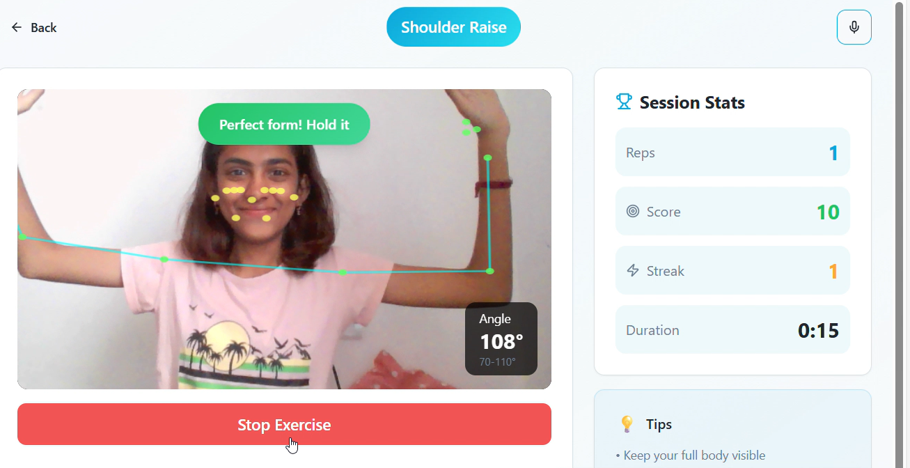

# PhysioMate AI – AI-Powered Physiotherapy Assistant

PhysioMate AI is an interactive web application designed to support physiotherapy exercises through pose visualization, movement angle measurement, exercise performance tracking and voice interaction.

The application provides visual feedback during exercise sessions, allowing users to monitor their movements and track exercise performance through an interactive interface.

## Project Overview

Performing physiotherapy exercises without continuous supervision can make it difficult for individuals to understand their movements, maintain proper exercise form and monitor their progress.

PhysioMate AI aims to address this challenge by providing an interactive digital platform that combines exercise monitoring, visual feedback and session statistics.

## Key Features

- **Real-Time Pose Visualization:** Displays body landmarks during supported exercise sessions.
- **Movement Angle Measurement:** Displays movement angles to help users monitor exercise positioning.
- **Repetition Counting:** Tracks the number of completed exercise repetitions.
- **Performance Scoring:** Displays exercise performance scores during sessions.
- **Streak Tracking:** Monitors consecutive repetitions.
- **Session Statistics:** Displays exercise duration, repetitions, score and streak information.
- **Voice Interaction:** Provides a voice interaction interface for application control.
- **Exercise Feedback:** Displays visual feedback to guide users during supported exercises.

## Application Screenshots

### Shoulder Raise – Exercise Monitoring

The exercise monitoring interface displays body pose landmarks, movement angle measurements and live session statistics.



*Figure 1: Shoulder Raise exercise monitoring interface.*

## Technology Stack

| Category | Technologies |
|---|---|
| Frontend | React.js |
| Programming Language | TypeScript |
| Build Tool | Vite |
| UI Components | shadcn/ui |
| Styling | Tailwind CSS |
| Backend Integration Structure | Supabase |
| Version Control | Git, GitHub |

## Application Architecture

```text
                 USER
                   |
                   v
           PHYSIOMATE AI
            WEB APPLICATION
                   |
                   v
          REACT + TYPESCRIPT
                   |
          -------------------
          |                 |
          v                 v
    VOICE INTERACTION   POSE VISUALIZATION
          |                 |
          -------------------
                   |
                   v
          EXERCISE MONITORING
                   |
                   v
          SESSION STATISTICS
          AND VISUAL FEEDBACK
```

*Note: This is a high-level conceptual representation of the application, not a verified backend processing architecture.*

## Project Structure

```text
physio-mate-ai/
│
├── public/
│
├── screenshots/
│   └── shoulder-raise-session.png
│
├── src/
│   ├── components/
│   ├── hooks/
│   ├── integrations/
│   │   └── supabase/
│   ├── lib/
│   ├── pages/
│   ├── utils/
│   ├── App.tsx
│   ├── App.css
│   ├── index.css
│   └── main.tsx
│
├── supabase/
├── package.json
├── index.html
└── README.md
```

## Installation and Setup

### Prerequisites

- Node.js
- npm
- Git

### 1. Clone the Repository

```bash
git clone https://github.com/RishithaKalava/physio-mate-ai.git
```

### 2. Navigate to the Project Directory

```bash
cd physio-mate-ai
```

### 3. Install Dependencies

```bash
npm install
```

### 4. Start the Development Server

```bash
npm run dev
```

Open the local development URL displayed in the terminal to access the application.

## Future Enhancements

- Improved pose estimation and movement analysis.
- Additional physiotherapy and rehabilitation exercises.
- Personalized exercise recommendations.
- Exercise history and progress visualization.
- Enhanced voice interaction capabilities.
- Improved accessibility and user experience.

## Project Objectives

- Explore the application of computer vision concepts in physiotherapy.
- Develop an interactive exercise monitoring interface.
- Provide visual feedback and exercise performance statistics.
- Build a modular and maintainable web application.
- Explore the integration of AI-related interaction capabilities into healthcare applications.

## Developer

**Rishitha Kalava**

- GitHub: [RishithaKalava](https://github.com/RishithaKalava)
- Project Repository: [PhysioMate AI](https://github.com/RishithaKalava/physio-mate-ai)
